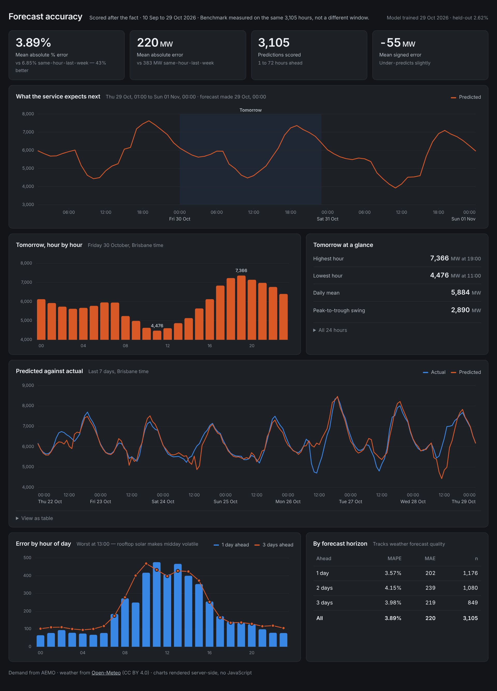

# Queensland Electricity Demand Forecasting

**Live dashboard:** https://qld-energy-forecast-production.up.railway.app/dashboard

**API:** https://qld-energy-forecast-production.up.railway.app/health

## In plain English

**The problem.** Queensland uses a different amount of electricity every hour of every
day, and the people running the grid have to know roughly how much is coming before it
arrives, so enough generation is ready. Guess too low and the grid is short; guess too
high and expensive plant runs for nothing.

**The data.** Two free public sources. AEMO publishes what Queensland actually used,
every five minutes. Open-Meteo gives the weather, which matters because how much power
people use depends mostly on how hot or cold it is and how much sun the rooftop solar
is getting.

**What it does.** It collects its own data every six hours, predicts demand for the
next three days, writes every prediction down, and then later compares each one
against what actually happened. Nobody has to run anything.

**How good it is.** Across 1,929 forecasts it was out by 3.7% on average. The obvious
simple method — assume this hour will be the same as this hour last week — is out by
6.6% on exactly the same hours. So this is about **44% better than the obvious
method**, which is the comparison that matters.

**What it can't do.** It cannot see more than about three days ahead, because that is
as far as the free weather forecast goes. It knows Queensland's public holidays, but
not school holidays or the quiet week between Christmas and New Year, so those are
still its weakest days.

## Architecture

The service fetches its own data, keeps it on a persistent volume, refreshes itself
every six hours, and logs every prediction so accuracy can be scored against reality
once it arrives.

## Results

### Model comparison

Figures below are for the model currently deployed, scored on the window it reports at
`/health`: trained on data up to 16 April 2026, scored on 16 April – 28 October 2026
(4,678 hours). The naive benchmark is scored on those same 4,678 hours, not on a
different window.

| Model | MAE | RMSE | MAPE |
|---|---|---|---|
| Seasonal naive benchmark | 308 MW | 479 MW | 5.78% |
| Linear regression | 227 MW | 307 MW | 4.17% |
| Random forest | 154 MW | 240 MW | 2.89% |
| **Gradient boosting (deployed)** | **141 MW** | **213 MW** | **2.62%** |

**A 54% reduction in error against the benchmark.**

These figures move slightly on every retrain, because the service keeps collecting data
and the 75/25 split moves forward with it. `/health` always reports the window the live
model was actually scored on, so the document and the service can be checked against
each other.

The benchmark — demand equals the same hour one week earlier — was built first
deliberately. Electricity demand is highly repetitive, so a naive method already gets
within 6%. Without that number, an accuracy figure means nothing.

> **On comparing like with like.** Measured across the full two years the benchmark
> scores about 7.2% MAPE, because the April–October window happens to be more
> predictable than average. Quoting the whole-period benchmark against a test-window
> model would overstate the improvement by roughly twelve percentage points. Every
> figure in the table above comes from the same 4,666 hours.

Linear regression nearly halving the benchmark error indicates the features are doing
most of the work, not the algorithm.

**The shipped model is not the scored model.** The split above exists to produce an
honest number on hours the model has never seen. A model shipped from that split would
never have seen the most recent quarter of history either, which is the part most like
tomorrow. So the final model is refitted on all 18,664 rows with identical settings,
and `/health` reports both windows:

    "model_evaluated_on": { "rows": 4666,  "start": "2026-04-15", "end": "2026-10-26" }
    "model_trained_on":   { "rows": 18664, "start": "2024-09-08", "end": "2026-10-26" }

### Production accuracy

1,929 forecasts made ahead of time between 8 September and 27 October 2026, scored
against what actually happened:

| | Model | Same-hour-last-week benchmark |
|---|---|---|
| MAPE | **3.69%** | 6.55% |
| MAE | **191 MW** | 337 MW |
| Hours scored | 1,929 | the same 1,929 |

**44% better than the benchmark on live forecasts.** The benchmark is recomputed from
the observations table for exactly the scored rows every time the dashboard loads, so
the comparison cannot drift out of date.

This is not a backtest. Each forecast was generated by the running service, stored, and
only later compared against observed demand.

It is worse than the 2.62% held-out figure for reasons that are all real: production
uses *forecast* weather rather than observed, and these span horizons from 1 to 72
hours rather than a single step.

### Accuracy by horizon

| Days ahead | MAPE | Hours scored |
|---|---|---|
| 1 | 3.34% | 672 |
| 2 | 3.57% | 648 |
| 3 | 4.22% | 609 |

Error grows with horizon, and the cause is the weather input rather than the model
recursing on its own predictions: a backtest supplied with *observed* weather holds
between 2.3% and 2.7% out to seven days, while production, supplied with *forecast*
weather, degrades as above. A better model would barely improve the three-day forecast.
Better weather input would.

`/forecast` reports these measured figures rather than asserting an accuracy.

### Where the model fails

Mean absolute error by hour of day, Brisbane time, from logged production forecasts:

| Time | Mean error |
|---|---|
| 2–5am | 82 MW |
| 11am–3pm | 413 MW |
| 6–7pm | 117 MW |

Midday error is **5.1 times** the overnight error, peaking at 457 MW at noon. This was
predicted from the exploratory analysis before the model was built: rooftop solar makes
midday grid demand volatile, and production runs on *forecast* solar radiation rather
than observed.

### Operational record

**18,855 hourly observations from 1 September 2024 to 26 October 2026 with zero missing
hours.** The deployed service refreshes itself every six hours without intervention,
including through a provider security incident and a platform-wide deployment pause.

## API

| Endpoint | Purpose |
|---|---|
| `GET /health` | Status, row count, data freshness, and which model is live |
| `GET /predict?timestamp=YYYY-MM-DDTHH:MM` | Demand in MW for an hour with known history |
| `GET /forecast?hours=N` | Recursive forecast for the next N hours (1–168), with measured accuracy |
| `GET /dashboard` | Accuracy of logged forecasts, scored against reality |
| `GET /export.csv` | Every logged forecast and its outcome |
| `GET /docs` | Interactive API documentation |

`/forecast` returns `hours_returned` alongside `hours_requested` — it stops when
forecast weather runs out rather than silently truncating.

## Features

| Group | Detail |
|---|---|
| Calendar | Hour, day of week, month, weekend flag |
| Cyclical | Hour and day-of-week as sine/cosine pairs, so 23:00 sits next to 00:00 |
| Weather | Temperature, apparent temperature, humidity, cloud cover, solar radiation |
| Degree days | Heating (below 18°C) and cooling (above 24°C) as separate features |
| Holidays | Queensland public holiday, and the day after one |
| Lags | Demand at 24h, 48h and 168h earlier |
| Rolling | 24-hour and 168-hour means, shifted to exclude the present |

Two deliberate exclusions:

- **No 1-hour lag**, despite a 0.885 correlation. Predicting tomorrow at 6pm would
  require tomorrow at 5pm, which does not exist at prediction time.
- **Price is excluded.** Tomorrow's wholesale price is not known when forecasting
  tomorrow's demand.

Rolling windows are shifted 24 hours before averaging so they never include the
current value.

Top feature importances: `demand_lag_24h` (0.75), `demand_lag_168h` (0.07),
`shortwave_radiation` (0.04).

### Public holidays, and the one that is not

Holiday flags look negligible by importance — `is_holiday` ranks 20th of 22 at 0.002 —
because they are zero on 97% of rows. Importance measures how often a feature is used,
not how much it matters when it is. On the days it does fire, it is the difference
between a usable forecast and an embarrassing one.

Measured by refitting the model before each holiday in the data and scoring that
holiday only, so nothing from the future is visible to it:

| | Holiday hours | Day after | Bias on holidays |
|---|---|---|---|
| Without the flags | 280 MW | 219 MW | +190 MW |
| With the flags | **178 MW** | **190 MW** | **-24 MW** |

That is 20 holiday days across 13 episodes, 36% lower error, improving 10 of the 13.
The bias is the real result: the old model forecast every public holiday as if it were
an ordinary working day and ran 190 MW high all day.

The headline accuracy barely moves – 2.67% to 2.62% MAPE on the held-out window, the
flags being the only difference – and it should not, because only three holidays fall
inside that window. Scoring 20 of them one at a time is exactly why the episode
backtest above exists: an annual average cannot show whether a fix aimed at 3% of days
worked.

**The Ekka is deliberately excluded.** The Royal Queensland Show is a Brisbane-only
holiday — the rest of the state, including the industrial load that dominates it, works
as normal, so state-wide demand barely dips. Flagging it made those days 54% worse
(166 to 256 MW) while excluding it cost nothing. Giving it a flag of its own did not
help either: with at most one previous Ekka in the training data there is nothing for
the model to learn the exception from. `is_statewide_holiday()` in
`src/features/build.py` is where that lives, and a test pins it.

## How forecasts are logged

Every forecast is stored with two separate timestamps, because they are not the same
thing:

- `made_at_utc` — the last observed hour the forecast was built from.
- `issued_at_utc` — the wall-clock time the row was written.

`lead_hours` is measured from the issue time, so a forecast can only claim to precede
its outcome if it genuinely did. Rows are appended, never replaced, so a refresh cannot
overwrite what was believed earlier. Rows written before this scheme was introduced
carry a NULL issue time rather than a guessed one, and the dashboard counts them
separately.

## Tests

    pytest -q

25 tests, run on every push by GitHub Actions against Python 3.12, the same version the
container uses. They pin the rules that fail silently rather than loudly: that each lag
reaches back exactly as far as it claims, that rolling means exclude the present, that
`Etc/GMT-10` is read as UTC+10, that a refresh appends rather than overwrites, and that
the API never advertises an accuracy it has not measured.

## Running locally

    python -m venv .venv

    .venv\Scripts\Activate.ps1          # Windows
    source .venv/bin/activate           # macOS and Linux

    pip install -e .
    pip install -r requirements.txt
    uvicorn src.api.main:app --reload

`requirements-api.txt` is the runtime list the container installs.
`requirements.txt` includes it and adds the notebook and test tooling, so neither
reaches the image.

## Running in Docker

    docker build -t qld-energy .
    docker run -p 8000:8000 qld-energy

No database is copied into the image. On an empty volume the container builds its own
from the source APIs before starting — about 20 seconds for two years of history. On
subsequent starts it finds the existing database and skips the build.

`REFRESH_HOURS` controls the background refresh interval (default 6).
`REFRESH_ENABLED=0` disables the background thread, which is what the tests do.

## Updating the data

    python scripts/daily_update.py

Safe to re-run at any time. Fetches only recent months, aborts without writing if any
source is unavailable, and exits non-zero so a scheduler can detect failure.

## Retraining

    python -m scripts.retrain

Scores on the held-out window, then refits on every row before saving. Prints both
windows so it is obvious what was measured and what was shipped. Each retrain also
writes a dated archive copy locally, so a revision that turns out worse can be compared
against and rolled back; archives are not committed.

`scikit-learn` is pinned in `requirements-api.txt` to the version that trained the saved
model — a pickled estimator is not guaranteed to load correctly across versions.

Note that MAPE is **not** comparable between retrains, because the time-based test
window moves forward with the data. Compare MAE, or hold the window fixed.

## Structure

    src/ingest/     fetchers, transforms, database
    src/features/   feature engineering
    src/models/     baseline, training, recursive forecasting
    src/api/        FastAPI service and dashboard
    scripts/        startup bootstrap and daily update
    tests/          25 tests, run in CI
    notebooks/      exploratory analysis and data notes
    docs/           architecture diagram and screenshots
    data/           database and raw API responses (not in git)

## Data notes

Findings from the inspection notebook that shaped the design:

**Timestamps mark the end of each interval.** AEMO publishes in UTC+10 with no daylight
saving. All data is converted to UTC on ingest.

**Open-Meteo mixes conventions in a single response.** `shortwave_radiation` is a
preceding-hour mean; everything else is instantaneous.

**Demand is lowest around 11am, not overnight.** `TOTALDEMAND` measures draw from the
grid, and rooftop solar supplies homes directly at midday — the duck curve. Price
follows the same shape, collapsing to around $13/MWh at 10am against $113 at 5pm, and
going negative 10% of the time. This is why solar radiation is a required feature rather
than an optional one, and why demand versus temperature is a U shape rather than a line.

**Cloud cover is a poor proxy for sunlight.** One sample day showed 77% cloud with near
clear-sky radiation, because total cloud includes high cirrus that blocks little light.
`shortwave_radiation` measures what actually reaches the ground.

**Two weather sources are needed.** The ERA5 archive is accurate but published about five
days late, and describes only the past. The forecast endpoint covers the recent gap and
the next three days. They overlap by two days, so there is no seam; where both cover an
hour, the archive wins.

## Known limitations

Deliberate and documented, not oversights.

- **School holidays and the Christmas shutdown are not flagged.** Public holidays are,
  but the quiet stretch from Boxing Day to early January is not a holiday by the
  calendar and still behaves like one. Christmas 2025 remains the single worst episode
  in the holiday backtest at 291 MW even with the flags on.
- **Holidays are flagged, not weighted.** Every state-wide holiday gets the same flag,
  so the model cannot distinguish a near-shutdown like Good Friday from a lighter one
  like Labour Day except through its other features.
- **No comparison against AEMO's own forecasts.** AEMO publishes pre-dispatch demand
  forecasts; this project does not yet measure itself against them.
- **One weather location.** Brisbane only, for a state that includes Townsville, Cairns
  and Gladstone industry.
- **Forecast horizon is capped by weather availability**, at roughly three days, and
  accuracy within that range is limited by weather forecast quality rather than by the
  model.
- **Retraining is manual.** The data refreshes itself; the model does not.
- **One split, hand-set hyperparameters, point forecasts only.** No rolling-origin
  cross-validation and no prediction intervals.
- **The local scheduled job depends on the laptop being on.** The deployed service is
  unaffected — it refreshes itself.
- **Python version mismatch locally.** Development runs 3.14; the container and CI both
  run 3.12, so the tested version is the shipped version.

## Data sources

- AEMO aggregated price and demand data
- Weather data by [Open-Meteo.com](https://open-meteo.com), CC BY 4.0
  (Zippenfenig, P. 2023, DOI 10.5281/ZENODO.7970649)

## Licence

MIT. See [LICENSE](LICENSE).
