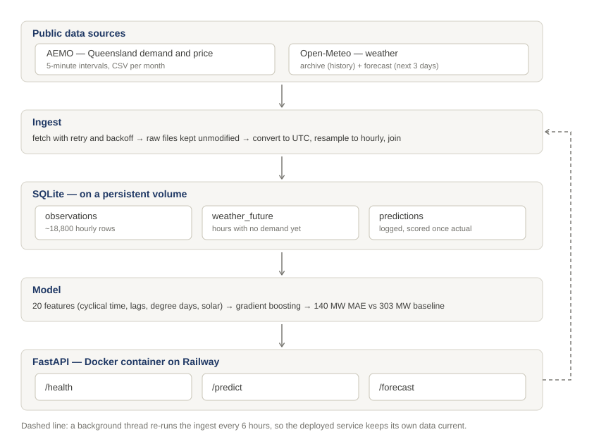

# Queensland Electricity Demand Forecasting

A self-updating service that forecasts electricity demand for Queensland from public
market and weather data.

**Live:** https://qld-energy-forecast-production.up.railway.app/health

## Architecture

The service fetches its own data, keeps it on a persistent volume, refreshes itself
every six hours, and logs every prediction so accuracy can be scored against reality
once it arrives.

## Results

### Model comparison

All models trained on data up to 12 April 2026 and scored on the same held-out
period, 12 April – 23 October 2026 (4,648 hours).

| Model | MAE | RMSE | MAPE |
|---|---|---|---|
| Seasonal naive baseline | 303 MW | 472 MW | 5.71% |
| Linear regression | 223 MW | — | 4.11% |
| Random forest | 152 MW | — | 2.85% |
| **Gradient boosting (deployed)** | **140 MW** | **207 MW** | **2.63%** |

**A 54% reduction in error against the baseline.**

The baseline — demand equals the same hour one week earlier — was built first
deliberately. Electricity demand is highly repetitive, so a naive method already gets
within 6%. Without that number, an accuracy figure means nothing.

> **On comparing like with like.** Measured across the full two years the baseline
> scores 421 MW MAE / 7.23% MAPE, because the April–October window happens to be more
> predictable than average. Quoting the whole-period baseline against a test-window
> model would overstate the improvement by about twelve percentage points. Every
> figure in the table above is from the same window.

Linear regression nearly halving the baseline error indicates the features are doing
most of the work, not the algorithm.

### Production accuracy

1,785 predictions made *before the fact* between 21 September and 23 October 2026,
scored against what actually happened:

| | Value |
|---|---|
| MAE | 182 MW |
| MAPE | **3.58%** |
| Predictions scored | 1,785 |

This is not a backtest. Each of these was generated by the running service, stored,
and only later compared against the observed demand.

It is worse than the 2.63% held-out figure, for three reasons, all of them real:
production uses *forecast* weather rather than actuals, the model was two months stale
for most of that period, and these span horizons from 1 to 72 hours rather than a
single step.

### What drives horizon degradation

| Days ahead | Production (forecast weather) | Backtest (actual weather) |
|---|---|---|
| 1 | 3.25% | 2.29% |
| 2 | 3.40% | 2.61% |
| 3 | 4.10% | 2.54% |

These two columns together isolate the cause.

The backtest supplies *real* weather at every horizon, so it measures only the model
recursing on its own predictions — and that barely compounds, holding between 2.3% and
2.7% out to seven days. Production supplies *forecast* weather, and a three-day
weather forecast is less accurate than a one-day one.

**So the horizon degradation is the weather forecast decaying, not the model.** A
better model would barely improve the three-day forecast; better weather input would.

Demand is strongly periodic and weather-driven, and both anchors survive recursion:
the daily cycle holds predictions in shape, and weather is supplied independently
rather than predicted.

*(The seven-day backtest figures were measured on the previous model revision. The
one- to three-day comparison above is current.)*

### Where the model fails

Mean absolute error by hour of day, Brisbane time:

| Time | Mean error |
|---|---|
| 2–5am | ~65 MW |
| 11am–3pm | ~270 MW |
| 6–7pm | ~105 MW |

Midday error is roughly four times the overnight error. This was predicted from the
exploratory analysis before the model was built: rooftop solar makes midday grid
demand volatile in a way the model cannot fully anticipate.

### Operational record

Between 21 September and 24 October 2026 the service ingested **792 consecutive hours
with no gaps**, refreshing itself every six hours without intervention — including
through a provider security incident and a platform-wide deployment pause.

## API

| Endpoint | Purpose |
|---|---|
| `GET /health` | Status, row count, data freshness, and which model is live |
| `GET /predict?timestamp=YYYY-MM-DDTHH:MM` | Demand in MW for an hour with known history |
| `GET /forecast?hours=N` | Recursive forecast for the next N hours (1–168) |
| `GET /docs` | Interactive API documentation |

`/forecast` returns `hours_returned` alongside `hours_requested` — it stops when
forecast weather runs out rather than silently truncating.

## Features

| Group | Detail |
|---|---|
| Calendar | Hour, day of week, month, weekend flag |
| Cyclical | Hour and day-of-week as sine/cosine pairs, so 23:00 sits next to 00:00 |
| Weather | Temperature, apparent temperature, humidity, cloud cover, solar radiation |
| Degree days | Heating (below 18°C) and cooling (above 24°C) as separate features |
| Lags | Demand at 24h, 48h and 168h earlier |
| Rolling | 24-hour and 168-hour means, shifted to exclude the present |

Two deliberate exclusions:

- **No 1-hour lag**, despite a 0.885 correlation. Predicting tomorrow at 6pm would
  require tomorrow at 5pm, which does not exist at prediction time.
- **Price is excluded.** Tomorrow's wholesale price is not known when forecasting
  tomorrow's demand.

Rolling windows are shifted 24 hours before averaging so they never include the
current value.

Top feature importances: `demand_lag_24h` (0.76), `demand_lag_168h` (0.06),
`shortwave_radiation` (0.04).

## Running locally

    python -m venv .venv
    .venv\Scripts\Activate.ps1
    pip install -e .
    pip install -r requirements.txt
    uvicorn src.api.main:app --reload

## Running in Docker

    docker build -t qld-energy .
    docker run -p 8000:8000 qld-energy

On an empty data volume the container builds its own database from the source APIs
before starting — about 20 seconds for two years of history. On subsequent starts it
finds the existing database and skips the build.

`REFRESH_HOURS` controls the background refresh interval (default 6).

## Updating the data

    python scripts/daily_update.py

Safe to re-run at any time. Fetches only recent months, aborts without writing if any
source is unavailable, and exits non-zero so a scheduler can detect failure.

## Retraining

    python -c "from src.ingest.database import read_all; from src.features.build import build_features; from src.models.train import train_and_save; print(train_and_save(build_features(read_all())))"

Saves the model with its feature list, metrics and training timestamp, so `/health`
reports what is actually deployed rather than relying on this file being current.
Each retrain also writes a dated archive copy, so a revision that turns out worse can
be compared against and rolled back.

`scikit-learn` is pinned in `requirements-api.txt` to the version that trained the
saved model — a pickled estimator is not guaranteed to load correctly across versions.

Note that MAPE is **not** comparable between retrains, because the time-based test
window moves forward with the data. Compare MAE, or hold the window fixed.

## Structure

    src/ingest/     fetchers, transforms, database
    src/features/   feature engineering
    src/models/     baseline, training, recursive forecasting
    src/api/        FastAPI service
    scripts/        startup bootstrap and daily update
    notebooks/      exploratory analysis and data notes
    docs/           architecture diagram
    tests/          automated checks
    data/raw/       unmodified API responses (not in git)

## Data notes

Findings from the inspection notebook that shaped the design:

**Timestamps mark the end of each interval.** AEMO publishes in UTC+10 with no
daylight saving. All data is converted to UTC on ingest.

**Open-Meteo mixes conventions in a single response.** `shortwave_radiation` is a
preceding-hour mean; everything else is instantaneous.

**Demand is lowest around 11am, not overnight.** `TOTALDEMAND` measures draw from the
grid, and rooftop solar supplies homes directly at midday — the duck curve. Price
follows the same shape, collapsing to around $13/MWh at 10am against $113 at 5pm, and
going negative 10% of the time. This is why solar radiation is a required feature
rather than an optional one, and why demand versus temperature is a U shape rather
than a line.

**Cloud cover is a poor proxy for sunlight.** One sample day showed 77% cloud with
near clear-sky radiation, because total cloud includes high cirrus that blocks little
light. `shortwave_radiation` measures what actually reaches the ground.

**Two weather sources are needed.** The ERA5 archive is accurate but published about
five days late, and describes only the past. The forecast endpoint covers the recent
gap and the next three days. They overlap by two days, so there is no seam; where
both cover an hour, the archive wins.

## Known limitations

Deliberate and documented, not oversights.

- **Forecast horizon is capped by weather availability**, at roughly three days, and
  accuracy within that range is limited by weather forecast quality rather than by
  the model.
- **Retraining is manual.** The data refreshes itself; the model does not. Two months
  elapsed between the last two retrains.
- **The local scheduled job depends on the laptop being on.** Windows Task Scheduler
  catches up after a missed start, but days when the machine is off leave gaps in the
  local prediction log. The deployed service is unaffected — it refreshes itself.
- **The database and model file are committed to Git** so a local `docker build` has
  data immediately. Production no longer depends on this, since the container
  bootstraps onto a persistent volume. Removing them from the image is a
  straightforward next step.
- **Python version mismatch.** Development runs 3.14, the container 3.12, because
  3.14 slim images are not yet reliable for all dependencies.
- **No automated tests yet.**

## Data sources

- AEMO aggregated price and demand data
- Weather data by [Open-Meteo.com](https://open-meteo.com), CC BY 4.0
  (Zippenfenig, P. 2023, DOI 10.5281/ZENODO.7970649)
